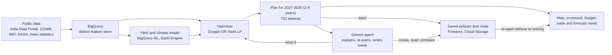
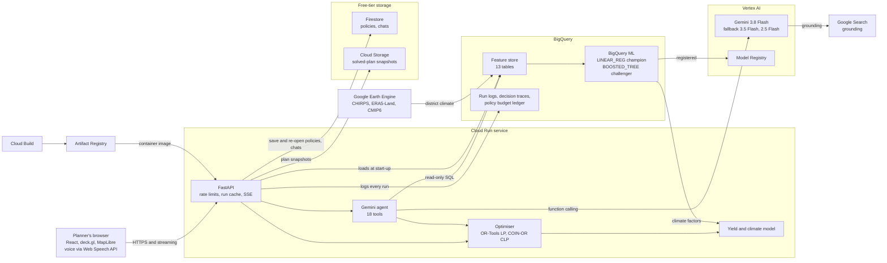
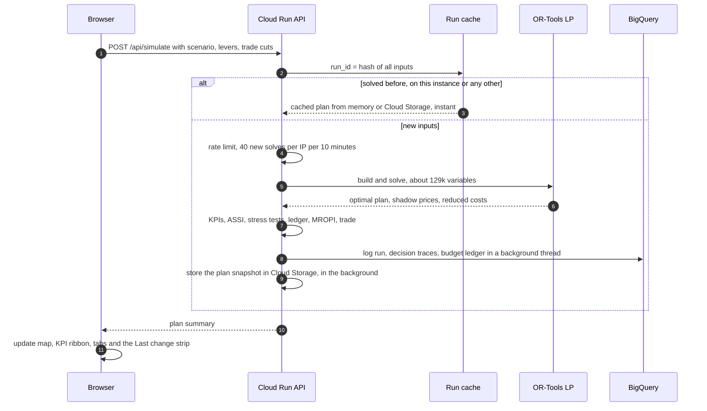
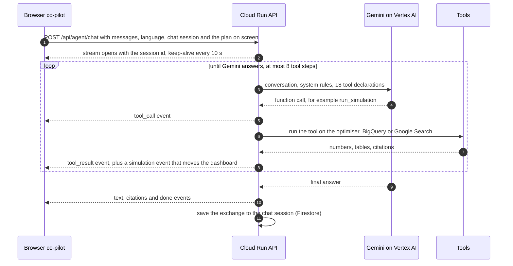
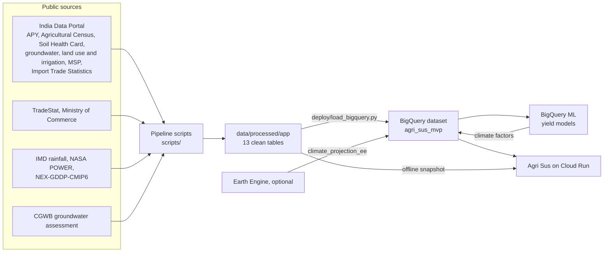

# How Agri Sus works

This document explains what Agri Sus does, what happens behind every click, and how the Google Cloud services fit
together. It is written for judges, reviewers and new team members: the first sections need no technical
background, and the later sections go into the detail.

Related documents:
- [DEPLOY.md](DEPLOY.md): deploy it yourself.
- [MODEL_CARD.md](MODEL_CARD.md): model assumptions and limits.
- [DEMO_VIDEO_SCRIPT.md](DEMO_VIDEO_SCRIPT.md): the 3–4 minute demo.
- [PERFORMANCE_REPORT.md](PERFORMANCE_REPORT.md): measured latency, load, Gemini, Lighthouse and model accuracy.
- [../data/README.md](../data/README.md): every dataset and cleaning step.

## Contents

1. [In one minute](#1-in-one-minute)
2. [The problem and who it is for](#2-the-problem-and-who-it-is-for)
3. [A tour of the screen](#3-a-tour-of-the-screen)
4. [Architecture on Google Cloud](#4-architecture-on-google-cloud)
5. [What happens when you…](#5-what-happens-when-you)
6. [Data: from public sources to BigQuery](#6-data-from-public-sources-to-bigquery)
7. [The models](#7-the-models)
8. [The Gemini agent in depth](#8-the-gemini-agent-in-depth)
9. [Deployment and operations](#9-deployment-and-operations)
10. [Security, privacy and responsible AI](#10-security-privacy-and-responsible-ai)
11. [Testing](#11-testing)
12. [Limitations](#12-limitations)
13. [Glossary](#13-glossary)
14. [Code map](#14-code-map)

---

## 1. In one minute

Agri Sus answers one planning question for India:

> *Which crops should change in which districts between 2027 and 2030 (or over any 2–8-year horizon from 2027), and
> which policy instruments should pay for it? The aim is for India to import fewer pulses and edible oils and pump less groundwater, without any district's
> farmers earning less and without putting cereal security at risk.*

It works in four steps:

1. **Data.** Public datasets are cleaned into a district-level feature store in **BigQuery**: 752 districts, 16
   crops the plan can shift (cotton and sugarcane stay at today's area), two seasons. The sources are the India Data
   Portal, the Central Ground Water Board (CGWB), IMD, NASA and DGCI&S trade statistics.
2. **Prediction.** A climate-aware yield model predicts 2027–30 yields under the CMIP6 climate projection and under
   any shock you choose. The model is an agronomic prior with a **BigQuery ML** boosted-tree challenger, and it can
   use climate data computed by **Earth Engine**.
3. **Optimisation.** A **Google OR-Tools** linear program chooses each district's crop mix for every season and
   year, and how to spend the policy budget, inside hard guardrails.
4. **Explanation and conversation.** The map and tabs compare the plan with doing nothing, and every decision is
   explained. A **Gemini agent on Vertex AI** answers questions and runs what-ifs. It reads the live outlook with
   **Google Search grounding**, queries BigQuery in plain English, and writes policy briefs in 11 languages.
5. **Saved policies.** Any plan, whether set up by hand or created by the agent in conversation, can be saved as a
   named policy. The levers and the full solved result go to **Firestore** and **Cloud Storage** (free tier), so a
   policy re-opens in about a second with its map and every number, and the agent can discuss and compare saved
   policies. Co-pilot conversations are saved there too.



**Headline result** (baseline scenario, default levers, 2030, versus doing nothing):

| Measure | Do nothing | Agri Sus plan |
|---|---|---|
| Sustainability index (ASSI) | 69.7 | **76.0** |
| Pulses and edible-oil import bill | $27.1 bn | **$21.5 bn** ($5.6 bn a year saved) |
| Groundwater pumped | 170.4 BCM | **161.7 BCM** (8.7 BCM a year saved) |
| Farmer income | 100% of today | **100.1%**, with no district below today |

Annual policy budget: ₹6,000 crore. The full table is in the [README](../README.md#results).

## 2. The problem and who it is for

| | |
|---|---|
| **Import dependence** | India spent **$23 bn** importing pulses and edible oils in FY 2024-25. If nothing changes, the model projects **$27.1 bn by 2030**. India grows only about 37% of the edible oil it uses and about 78% of its pulses. |
| **Groundwater** | Paddy in the Punjab–Haryana belt draws groundwater at **150–300% of recharge**. In the 2030 do-nothing case, **75 districts** are over-exploited. |
| **Why it is hard** | Any shift must keep farm income, keep India self-sufficient in cereals, leave room for rice exports, stay within a budget, and survive El Niño, heatwaves and supplier shocks. The plan covers 752 districts × 16 crops × 2 seasons × 4 years by default (2 to 8), with national balances linking them all. That is too much to reason about by hand or inside a chat prompt. |

**Who uses it**
- **Primary users:** agriculture planners in the Union Department of Agriculture & Farmers Welfare and in state
  agriculture departments. They set the levers, compare scenarios, check the budget, and take a one-page brief to
  the Secretary.
- **Secondary users:** district officers, Farmer Producer Organisations (FPOs) and extension staff. They ask the
  co-pilot, in their own language and by voice, what to grow next season and why.

**Why an optimiser plus an agent, and not just a chatbot?** The optimiser finds a plan that is provably the best
under the rules. Gemini explains the plan, drives it ("what if…?") and connects it to today's news. **The agent
never invents numbers: every figure it gives comes from a tool result.**

## 3. A tour of the screen

| Area | What it shows | What you can do |
|---|---|---|
| **Header** | App name, data source and model status | **📁 Policies** (the shared library of saved policies). **✦ Policy brief** (one-page brief). **How it works** (guided tour). **Method & data** (method notes and sources) |
| **Scenarios** (left) | Baseline (CMIP6 SSP2-4.5), 2028 El Nino drought, Palm-oil price shock, Zero groundwater depletion mandate, Indonesia halts palm-oil exports, Canada lentil supply cut, Wheat-belt Rabi heatwave (2029), **✦ Gemini live outlook** | One click loads a pre-solved plan. Shock scenarios jump the view to the shock year |
| **Levers** (left) | Groundwater guardrail; budget mode (**Fixed budget** or **Least cost to hit target**); three instrument check-boxes; eight sliders, the first being the **plan horizon** (2–8 years from 2027); a trade-shock picker for several countries and products at once. Each lever is tagged **limiting**, **not limiting** or **not reached** for the current plan | Change anything, then **Run optimizer** (a progress bar shows the expected solve time). **Reset** restores the defaults. **💾 Save as policy** keeps the plan on screen |
| **KPI ribbon** (above the map) | Sustainability index, import bill (with pulses and oil self-sufficiency and whether the import target is met), groundwater pumped, farmer income, food security (cereal self-sufficiency) | Hover over ⓘ for plain-language definitions |
| **Map** (centre) | All districts, in nine layers: District sustainability score, Groundwater use vs recharge, Legume share, Paddy share, Groundwater saved, Paddy area change, Farmer income vs today, Policy outlay, Public return per rupee (MROPI) | **▶** animates the plan years (2027 → 2030 by default). Toggle **Do nothing / Agri Sus plan / Difference**. **Zoom to state**. Hover for district values; click a district for its card |
| **Scorecard** (on the map) | ASSI for doing nothing vs the plan in the selected year | Use the year scrubber across the plan years |
| **Saved-policy banner** (above the map) | When a saved policy is open: its name, scenario, date, and "rendered from its snapshot, no re-run" | **✦ Ask about it** sends the policy to the co-pilot. **All policies** opens the library |
| **Tabs** (below the map) | 🌍 Sustainability forecast · 💰 Budget & returns · 🚢 Trade shocks · 🏆 State leaderboard · 📈 Trajectory · ⚖ Binding guardrails | See the sections below. "Show on map" in the budget tab switches to the MROPI layer |
| **District card** | **Plan & why**: crop moves with reasons, rejected alternatives, rotation timeline, outlay by instrument, MROPI, a sustainability radar. **🌱 Next crop**: the ranked candidate crops for the next season | **✦ Ask the Co-pilot about…** sends the district to the co-pilot |
| **"Last change" strip** | After each re-run, what moved and why, or why nothing moved | — |
| **Co-pilot** (right) | Each step in plain language (*"Reading the national scorecard"* → *"National scorecard ✓"*), the answer, source links, model tag, and an **Open policy** button when it has saved a policy | Type or use **🎤** voice; pick one of 11 languages; **🔊 Listen**. **💬 Chats** lists earlier conversations (shared, deletable); **＋ New chat** starts over. Suggestion chips show while the chat is empty |

The six tabs in more detail:
- **🌍 Sustainability forecast:** ASSI from 2027 to 2030 with its four pillars, the stress-test band, and the Gemini
  outlook rationale when that scenario is active.
- **💰 Budget & returns:** the instrument mix and the budget path, **the whole-plan total** (outlay, public returns
  and net cost over all plan years; in least-cost mode, the total cost of hitting the target), the fiscal ledger,
  and MROPI tiers.
- **🚢 Trade shocks:** who India buys each pulse and edible oil from, how concentrated the suppliers are, and how much
  must be replaced at home after a cut. Several cuts (country × product) can be combined.
- **🏆 State leaderboard:** states ranked by sustainability gain, water saved, paddy → pulses shift and outlay. Click
  a state to fly to it.
- **📈 Trajectory:** every KPI, year by year, for doing nothing and for the plan.
- **⚖ Binding guardrails:** the national constraints that limit the plan, with their shadow prices.

## 4. Architecture on Google Cloud



| Google product | What Agri Sus uses it for | Code |
|---|---|---|
| **Cloud Run** | Hosts the API and the web app in one container: HTTPS, autoscaling (1–5 instances), a least-privilege service account | `Dockerfile`, `deploy/deploy.sh` |
| **Vertex AI: Gemini** | The live agent (function calling, 18 tools, including creating and reading saved policies), policy briefs in 11 languages, and the climate and price outlook. Model chain `gemini-3.8-flash` → `gemini-3.5-flash` → `gemini-2.5-flash` | `backend/app/agent.py`, `gemini.py` |
| **Grounding with Google Search** | Cited answers on current monsoon and ENSO outlooks, prices and policy. The outlook is turned into structured shocks for the optimiser | `backend/app/gemini.py` |
| **BigQuery** | Feature store (partitioned and clustered). Every simulation run, decision trace and budget-ledger row is logged. The agent queries it in plain English | `deploy/load_bigquery.py`, `bigquery/01_schema.sql`, `03_analytics.sql` |
| **BigQuery ML** | Two yield models on 105,000 district-crop-years: a `LINEAR_REG` champion and a `BOOSTED_TREE_REGRESSOR` challenger. The challenger is promoted only if it wins on the 2020–24 hold-out | `bigquery/02_bqml_yield_model.sql`, `backend/app/data.py` |
| **Vertex AI Model Registry** | Both BigQuery ML models are registered automatically (`MODEL_REGISTRY = 'VERTEX_AI'`) | `bigquery/02_bqml_yield_model.sql` |
| **Google Earth Engine** *(optional)* | District climate from CHIRPS, ERA5-Land and NASA NEX-GDDP-CMIP6, averaged over each district polygon, written to BigQuery | `scripts/gee_climate.py`, `bigquery/04_climate_from_earth_engine.sql` |
| **Firestore** *(free tier)* | The shared library: saved-policy metadata (levers, headline numbers) and co-pilot chat sessions, plus one small "version stamp" per list so a listing costs a single read when nothing changed | `backend/app/store.py`, `policies.py`, `chats.py` |
| **Cloud Storage** *(free tier)* | Snapshots of solved plans (gzipped JSON plus the district table as Parquet): every saved policy keeps its full result (`policies/`), and solved runs are cached per model version (`runs/`, deleted after 30 days by a lifecycle rule) so other instances and restarts reuse them instead of solving again | `backend/app/store.py`, `service.py` |
| **Cloud Build + Artifact Registry** | Builds the container in the cloud and stores the image. `cloudbuild.yaml` supports push-to-deploy | `deploy/deploy.sh`, `cloudbuild.yaml` |
| **IAM** | The app runs as its own service account with only the roles it needs | `deploy/deploy.sh`, `deploy/grant_dataset_access.py` |
| **Google OR-Tools** (open source, by Google) | The linear-programming optimiser | `backend/app/optimizer.py` |

**Offline mode.** Without a Google Cloud project, the same container runs on the bundled CSV snapshot. It uses
DuckDB for the SQL tool, a rule-based co-pilot, and local disk for saved policies and chats. `/api/meta` always says which mode is live (`data_backend`,
`gemini.backend`, `yield_engine`, `climate_source`).

## 5. What happens when you…

### 5.1 …open the site

1. Cloud Run keeps one instance warm (`min-instances 1`), so visitors almost never wait for a cold start.
2. When an instance starts, it loads the feature store: from BigQuery when `DATA_BACKEND=bigquery`, otherwise from
   the CSV snapshot. It then **pre-solves every scenario in the background** (about 7 minutes), which is why
   clicking a scenario takes about 2 seconds instead of 40 or more. Once one instance has solved them, the plans
   are in Cloud Storage, so later instances and restarts load them in seconds instead of solving again.
3. The browser loads the React app. It fetches `/api/meta` (data source, Gemini status, yield engine, languages),
   `/api/geo` (district shapes) and the baseline plan.

### 5.2 …change a lever and press Run optimizer



- The `run_id` is a hash of every input. Identical requests share one solve, even when they arrive at the same time
  (in-flight de-duplication). Recent plans are kept in a memory cache, and every solved plan is also kept in Cloud
  Storage for 30 days.
- **Plan horizon.** The *Plan horizon* slider sets how many years the transition takes (2–8, from 2027). The import
  target, groundwater caps and glide path all end in the final year, and every tab, the year scrubber and the map
  animation follow the chosen years. Longer plans have more variables, so they take longer to solve: while it
  solves, a progress bar counts towards this instance's typical solve time (`GET /api/solve-estimate`).
- A fresh national solve takes **about 40 seconds** on Cloud Run with 2 vCPUs (37–48 s measured). A cached plan
  comes back in 1–2 seconds, most of it spent sending the 2.5 MB plan. See [PERFORMANCE_REPORT.md](PERFORMANCE_REPORT.md).
- BigQuery logging never slows the answer, because it runs in a background thread.

### 5.3 …ask the co-pilot



- The answer streams as **Server-Sent Events**:
  - event types: `model`, `session`, `tool_call`, `tool_result`, `simulation`, `policy`, `text`, `citations`,
    `done`, `error`;
  - a keep-alive comment goes out every 10 seconds, and gzip is bypassed so each step shows the moment it happens.
- The co-pilot shows each step in plain language: *"Explaining the district's plan"* while it works, then
  *"District plan ✓"*. Tool names, arguments and raw summaries are never shown to the user.
- The co-pilot knows which plan is on screen (`run_id`), so *"save this"* or *"why did this plan cut paddy in
  Sangrur?"* refer to what you are looking at.
- When a tool re-runs the plan, the `simulation` event loads that plan into the dashboard. That is why the map,
  sliders and tabs move when you ask *"what if the budget is ₹20,000 crore?"*
- **Voice** uses the browser's built-in Web Speech API: 🎤 turns speech into text and 🔊 reads answers aloud. Only
  the text of the question is sent; no audio reaches the Agri Sus server.

### 5.4 …pick "✦ Gemini live outlook"

1. `GET /api/forecast` asks Gemini, **grounded with Google Search**, for the current ENSO and IMD outlook and global
   oilseed and pulse prices.
2. Gemini returns structured JSON:
   - for each year 2027–34 (so it covers the longest plan): the ENSO phase, the Kharif rainfall anomaly (%), the Rabi
     temperature anomaly (°C) and a confidence level. Years far ahead are expected to be near climatology with low
     confidence;
   - import-price multipliers;
   - a short rationale.
3. The values are clamped to safe ranges (rain −30% to +20%, heat −1 to +3 °C, prices 0.6× to 2.0×). The outlook is
   cached for 6 hours.
4. The shocks run through the optimiser as the `gemini_outlook` scenario, for whatever plan horizon is set
   (shocks in years outside the plan are ignored). The 🌍 tab shows *"Gemini outlook: rationale"*.

### 5.5 …click a district

- **Plan & why** (`GET /api/district/{code}`): the decision trace for that district.
  - Crop moves for each year, with their reasons.
  - Rejected alternatives, with their reduced costs.
  - The binding constraints that shaped the moves.
  - A rotation timeline, the groundwater stage, the outlay by instrument and MROPI.
  - A radar of the district score (water, soil, diversity).
- **🌱 Next crop** (`GET /api/district/{code}/candidates`): every candidate crop for each season of the chosen plan
  year.
  - For each crop: the decision (expand, keep or reduce), area today → plan, climate-adjusted yield, irrigation need,
    net margin, and flags (groundwater cap, heat, rotation).
  - It names the recommended next crop after the preceding season's crop, and the closest rejected alternative with
    the reason.

*Example: Sangrur (Punjab).*
- Groundwater is pumped at 310% of recharge.
- The plan moves 10,172 ha from paddy to moong by 2030, saving 50 million m³ of water a year.
- Moong is the recommended Kharif 2027 crop; sesame is the closest rejected alternative.

### 5.6 …write a policy brief

1. `POST /api/brief` with the plan, the scope (India or the state you zoomed to) and the language.
2. The server builds a **fact sheet** (JSON) from the plan: KPIs, ASSI by year and pillar, stress tests, budget and
   ledger, MROPI tiers, the top water-saving districts and any trade shock.
3. Gemini writes at most 400 words with fixed sections, in the chosen language, at temperature 0.2. The instruction
   is *"use ONLY the facts in the JSON… cite numbers exactly"*.
4. The brief is cached per plan, scope and language. A failed Gemini call is never cached. Without Gemini, a
   deterministic English template fills the same sections from the same facts.
5. Click **Print / PDF** or **Download .md**.

### 5.7 …save, open and discuss a policy

A **policy** is a named, saved plan: its levers (scenario, budget mode, instruments, sliders, horizon, trade cuts)
and the complete solved result.

```mermaid
sequenceDiagram
  autonumber
  participant B as Browser
  participant A as Cloud Run API
  participant F as Firestore
  participant S as Cloud Storage
  B->>A: POST /api/policies with run_id, name, note
  A->>S: write the plan snapshot to policies/ID (JSON + Parquet)
  A->>F: write the policy document: levers, headline KPIs, totals
  A->>F: bump the library's version stamp
  A-->>B: saved, Open it
  B->>A: GET /api/run/p-ID (open the policy)
  A->>S: read the snapshot, no optimiser run
  A-->>B: the plan, exactly as saved
  B->>B: restore levers, scenario, map, tabs; show the saved-policy banner
```

- **Save.** **💾 Save as policy** (under the levers) saves the plan on screen; it is disabled while the levers have
  unsaved changes, so a policy always matches its numbers. The name is suggested from the levers.
- **Library.** **📁 Policies** lists every saved policy with its scenario, date, headline numbers (ASSI, import
  saving, water saved, total outlay over the plan) and note. You can open it, ask the co-pilot to compare it with the
  plan on screen (**✦ Ask**), rename it, delete it (to *Deleted*, restorable) and delete it permanently.
- **Open.** A policy opens from its snapshot in about a second: the levers, scenario, map, KPI ribbon, every tab,
  district cards and the policy brief all come back exactly as saved. If a snapshot is ever missing, the server
  re-solves from the saved levers once and flags the result as recomputed.
- **Discuss.** **✦ Ask about it** on the banner, or any question naming a policy, uses the agent's policy tools:
  `list_policies`, `get_policy` (levers, final-year KPIs, totals over the plan, top states) and `create_policy`.
- **Create by conversation.** Ask *"Create a 6-year plan for an El Niño year and save it as El Niño-proof"*, or
  answer *yes* when the co-pilot offers to save a what-if. The agent sets every lever itself, solves, saves the
  policy, and shows an **Open policy** button.
- **Listing is cheap.** Each instance caches the policy list and re-validates it with one Firestore read of a
  version stamp that every write bumps, so the library list costs one read rather than one per policy.

### 5.8 …come back to a conversation

- Every co-pilot exchange is saved to a **chat session** in Firestore: the question, the answer, its sources, the
  plans it showed and any policy it created.
- **💬 Chats** lists recent sessions (shared by everyone, no login). Click one to continue it, or delete it.
  **＋ New chat** starts a fresh session.
- At most 200 sessions are kept; the oldest are dropped automatically.

## 6. Data: from public sources to BigQuery



| Dataset | What it gives Agri Sus |
|---|---|
| **Area, Production & Yield** (APY / UPAG, India Data Portal) | District × crop × season area and yield. The 2020–24 average is the baseline; 2004–24 trains the yield models |
| **Agricultural Census: crop** | Irrigated vs unirrigated area by crop (2010-11), kept as a district × crop irrigation reference table |
| **Agricultural Census: non-crop** | Farm holdings (average holding size), wells and tubewells per district |
| **Soil Health Card** | Village-level nutrient samples (10.8 million rows) aggregated to district soil N, P, K, organic carbon and pH. They feed the district profile and the BigQuery ML yield features |
| **Groundwater** (CGWB wells via India Data Portal, plus the CGWB 2024 assessment) | Water depth and its trend, and each district's *stage of extraction* (% of recharge pumped), which drives the groundwater cap and the water pillar |
| **Land use: sources of irrigation** | Net irrigated area by canal, tank, tubewell and well. This gives each district's irrigation coverage (which sets the rainfed share in the yield model), the groundwater share of irrigation, and the canal supply in the water-availability rule (CWAR) |
| **Minimum Support Price** | MSPs to 2026-27, used for crop margins and price-deficiency payments |
| **Export and import (TradeStat)** | HS 8-digit trade, used for the national import bill and food balance |
| **Import Trade Statistics** (India Data Portal, DGCI&S) | Country × product × month imports, used for supplier shares, concentration and trade shocks |
| Climate | IMD gridded rain and NASA POWER temperature (history); NEX-GDDP-CMIP6 SSP2-4.5 (2026–30). Optionally Earth Engine: CHIRPS, ERA5-Land, CMIP6 |
| Reference | CACP cost of cultivation, FAO-56 / ICAR crop constants (water need, nitrogen credit, oil recovery) |

- The pipeline scripts are `fetch_idp.sh`, `build_datasets.py`, `build_features.py`, `build_geo.py`,
  `build_trade_idp.py`, `fetch_gwra.py`, `fetch_climate.py` and `gee_climate.py`. They clean, join and impute: missing
  context values take the state median and are flagged. District splits are mapped to their parent districts.
- `deploy/load_bigquery.py` loads the 13 app tables with descriptions. Tables are partitioned by `agri_year` where
  they have one and clustered on their filter columns.
- `bigquery/01_schema.sql` creates the log tables: `simulation_runs`, `simulation_decision_traces`,
  `policy_budget_ledger`. They are time-partitioned.
- Every source, file and cleaning decision is listed in [data/README.md](../data/README.md).

## 7. The models

### 7.1 Yield and climate

- **Agronomic prior** (always available):
  `yield = trend-adjusted 5-year baseline × climate_factor`, where `climate_factor = clip(1 + λ·Σ βₖ·xₖ, 0.4, 1.3)`.
  λ is a single calibrated shrinkage factor.
  - The terms cover rainfall deficit or excess (scaled by the rainfed share), Tmax anomaly, terminal heat days for
    wheat, dry spells and extreme-rain days.
  - The coefficients come from the published literature; the table is in [MODEL_CARD.md](MODEL_CARD.md#form).
- **BigQuery ML champion and challenger**, both trained on 2004–19 and tested on a 2020–24 hold-out:
  - `yield_climate_response` (`LINEAR_REG`, the champion): an unconstrained twin of the prior;
  - `yield_boosted_tree` (`BOOSTED_TREE_REGRESSOR`, the challenger): learns crop × region × weather interactions.
- **Promotion rule:** with `YIELD_MODEL=auto`, the app uses the boosted tree's climate factors **only if** its
  hold-out WMAPE beats the champion's. `/api/meta` → `yield_engine` reports the active engine, both scores and the
  reason.
- **Earth Engine** (optional) recomputes district climate over whole district polygons rather than the centroid. The
  deploy script then retrains BigQuery ML on it and points the app at it (`climate_source` in `/api/meta`).
- **Honest limit:** at district level the model does not beat a simple persistence forecast for single-season
  yields: on the 2020–24 hold-out, the prior's WMAPE is 18.2% against 17.9% for persistence. It is used for
  **directional climate shocks** in a multi-year plan, not for point forecasts. See [MODEL_CARD.md](MODEL_CARD.md).

### 7.2 The optimiser

| Element | What it does |
|---|---|
| **Decision variables** | Hectares `area[d,c,s,t]` for every district × candidate crop × season (Kharif, Rabi) × plan year, plus the policy outlay by instrument. The plan runs 2027–30 by default; the *Plan horizon* lever sets 2–8 years from 2027 |
| **Glide path** | `area[t] = baseline + (t − 2026)/H × (area[final] − baseline)` for a plan of H years. Each district moves an equal step each year towards its final-year mix (a quarter a year in the default 4-year plan), so it never pays farmers to switch and then switch back |
| **Calibration (PMP)** | Today's crop mix is treated as each district's own optimum, revealed by farmers' choices. The LP cannot "discover" profit farmers are ignoring: every move must be paid for by a public benefit (water, imports, soil) |
| **Hard constraints** | Season land (at most 3% may be left fallow); year-on-year flexibility (staples shrink at most 15% a year, other crops 5%); maximum land shift per year; water availability (CWAR) blocks expansion where water is short; a national seed and market scale-up cap per crop; **each district's farm income ≥ today**, funded by the instruments within the budget |
| **Soft constraints** (penalised, so every scenario solves and any shortfall is reported) | Cereal self-sufficiency floor, rice and wheat floors (including rice exports), district groundwater caps ramping to the target, legume-share ramp, the final-year import-bill target (ramped linearly) and any supplier cuts |
| **Objective** (₹ crore) | Farmer welfare + strategic value of imports avoided + soil nitrogen credit − groundwater cost − extra cost of public funds (MCPF 1.25) − transition costs − penalty on soft-constraint shortfalls |
| **Size and speed** | About 129,000 variables and 124,000 constraints for all India (baseline, 4 years); the size grows in proportion to the number of plan years. COIN-OR CLP (through OR-Tools) solves the default plan in about 10 seconds; GLOP is the fallback |
| **Budget modes** | *Fixed budget*: the best plan for the money. *Least cost*: minimise the budget, with the import target as a hard constraint. Both report the budget for each year **and the total over the whole plan** (outlay, public returns, net cost); the baseline least-cost plan needs ₹26,246 crore over 2027–30 and returns ₹1.47 lakh crore |

Default levers: at most 12% of a district's land shifted a year; cereal floor 101.5%; groundwater guardrail
"cap 80" (over-exploited and critical districts ramp towards 80% of recharge); a 25% import-bill cut target;
₹6,000 crore a year; 75% of rice exports retained; 90% MSP realisation for non-procured crops; seed and market
scale-up 5% a year.

### 7.3 Policy instruments, fiscal ledger and MROPI

| Instrument | How it works in the model |
|---|---|
| **Income-parity transfer (DBT)** | Cash per district, as needed, so farm income stays at or above today. Similar to Haryana's *Mera Pani Meri Virasat* |
| **Seed & FPO kit** | ₹4,000 per hectare per season in kind; +10% yield on pulses and oilseeds |
| **Price-deficiency payment** | Tops prices up to MSP (+3% admin cost) and removes half of the farmer's risk premium for switching. Similar to PM-AASHA |

- **Fiscal ledger.** The outlay is set against what it returns: forex on imports avoided, the farm-power subsidy on
  water not pumped (₹1.5/m³), and the urea subsidy saved through legume nitrogen (₹32,000/t).
  - **Public return** = all three returns ÷ outlay. In the baseline plan this is **8.2×**.
  - **Budget payback** = power + urea only ÷ outlay, because forex is an economy-wide gain, not money paid back to the
    exchequer.
- **MROPI** is the public return per rupee in each district:
  - Tier 1: ≥ 10×;
  - Tier 2: 1–10×;
  - Tier 3: < 1×. These districts are funded for farm income and aquifer security, not for payback;
  - Self-financing: no outlay, positive return;
  - No outlay: no public money spent and no net public return.

  MROPI is also a map layer.

### 7.4 Trade shocks and supplier concentration

- Supplier shares come from India Data Portal *Import Trade Statistics*, using the latest complete year (FY 2024-25).
- A supplier cut ("Indonesia halts palm-oil exports") becomes a tonnage. It is phased in over the plan years (¼, ½,
  ¾, all in the default 4-year plan) and enters the LP's commodity balance.
- Up to 8 cuts can be combined: several countries for one product, or several products (for example, 50% less palm
  oil from Indonesia and Malaysia plus 40% less lentil from Canada). Cuts on the same commodity group add up.
- The result shows the substitute crops and districts that replace it, any shortfall, and the remaining suppliers.
  *Example:* Indonesia supplies 49% of India's palm oil (3,882 kt). The plan replaces about 2.2 Mt at home by 2030,
  mainly with groundnut, mustard and soybean, and lists Malaysia (31%), Thailand and Singapore as other suppliers.
- **Supplier concentration** is the Herfindahl index (HHI, 0–1) of country shares for every pulse and edible oil.

### 7.5 Sustainability index, district score and stress tests

**ASSI (0–100)**, the Agri Sustainability & Self-reliance Index, uses one absolute scale, so doing nothing and the
plan are measured with the same yardstick:

| Pillar | Weight | Score |
|---|---|---|
| Self-reliance | 30% | Average of pulses and edible-oil self-sufficiency, each capped at 100% |
| Water | 30% | From the groundwater stage of extraction: ≤ 60% of recharge scores 100, 100% scores 71, ≥ 200% scores 0 |
| Soil | 20% | Legume share of cropped area against a one-in-three rotation target (33.3%) |
| Diversity | 20% | 1 − HHI of crop-area shares |

- **District sustainability score (0–100):** water 40%, soil 30%, diversity 30%. Farmer income is a hard guardrail,
  not a scored pillar.
- **Stress tests:** the *fixed* plan is re-scored, without re-optimising, under three unplanned climate shocks:
  - El Niño 2028: −18% monsoon, +0.8 °C;
  - Rabi heatwave 2029: +2.2 °C;
  - back-to-back weak monsoons 2029–30: −12% each year.

  In the baseline plan the worst-year ASSI is 71.6, and the plan still beats doing nothing under every shock.

### 7.6 Explainability

- **Shadow prices (duals)** of the binding national constraints show what each guardrail costs the plan
  (⚖ Binding guardrails tab).
- **Reduced costs** explain why a crop was rejected in a district: the cost to the plan of forcing one hectare of it.
- **Lever tags** (*limiting*, *not limiting*, *not reached*) come from the duals, so a planner can see which knob
  actually holds the plan back.
- **"Last change" strip:** after each re-run it says what moved, or why nothing moved, for example because the lever
  is not limiting.
- **Decision traces** for every district are logged to BigQuery (`simulation_decision_traces`) for audit.

## 8. The Gemini agent in depth

**Tools.** Gemini chooses among 18 functions; every number in its answers comes from one of them.

| Tool | What it does |
|---|---|
| `get_national_scorecard` | National KPIs (ASSI, import bill, self-sufficiency, groundwater, income) for a scenario, plan vs doing nothing |
| `run_simulation` | Re-runs the optimiser with custom levers and/or climate shocks; returns KPIs, trajectory and binding constraints |
| `solve_min_budget` | Least-cost mode: the smallest budget and instrument mix that meets the import target |
| `decompose_trade_target` | Turns "cut country X's product by N%" into tonnes and hectares, then re-runs the optimiser with the cut |
| `get_trade_dependencies` | Who India buys each pulse and edible oil from: shares, HHI, 6-year history |
| `get_fiscal_ledger` | Outlay by instrument and year, forex, power and urea returns, MROPI tiers |
| `get_district_allocation_audit` | Next-crop audit for a district and year |
| `get_sustainability_outlook` | ASSI forecast, pillars, stress tests and the state ranking |
| `get_district_profile` | Water, soil, climate and cropping profile of a district |
| `explain_district` | The decision trace for a district |
| `predict_yield` | Climate-aware yield for a crop and district, with an optional shock |
| `get_schema` | Lists the BigQuery tables and columns |
| `query_bigquery` | Read-only SQL over the BigQuery dataset (NL→SQL) |
| `web_grounded_search` | A Google Search-grounded answer with citations |
| `gemini_outlook_forecast` | The grounded 2027–34 outlook, run through the optimiser for the chosen plan horizon |
| `list_policies` | The shared library of saved policies, with headline numbers and whole-plan totals |
| `get_policy` | One saved policy (or the plan on screen): levers, KPIs for every plan year, budget totals, trade cuts and binding constraints, read from its snapshot |
| `create_policy` | Saves the plan on screen, or a plan with the levers the agent chose, as a named policy; the app then shows **Open policy** |

`get_national_scorecard`, `get_fiscal_ledger`, `get_sustainability_outlook`, `explain_district` and
`get_district_allocation_audit` also take a `policy` argument, so the agent can analyse any saved policy (or the
plan on screen) from its snapshot without re-running the optimiser. `run_simulation`, `solve_min_budget` and
`create_policy` accept the plan horizon (`horizon_years`, 2–8) and several trade cuts.

**System rules.** The agent:
- never invents numbers: every figure comes from a tool, and it names the tool or model that produced it;
- cites sources for current events, prices and outlooks;
- states trade-offs and binding constraints honestly, and flags model limits;
- answers in plain language, in the language picked in the co-pilot;
- after a what-if, offers to save it as a policy, and saves only when the user asks or agrees (never claims a save
  that did not happen).

**Loop and limits**

| Setting | Value |
|---|---|
| Tool steps per question | At most 8 (`AGENT_MAX_STEPS`) |
| Thinking budget | 1,024 tokens (`GEMINI_THINKING_BUDGET`) |
| Gemini call timeout | 90 s (`GEMINI_TIMEOUT_S`) |
| Overall deadline | 240 s (`AGENT_DEADLINE_S`) |
| Per answer | At most 16 tool calls, 3 new optimiser solves, 3 web searches and 2 saved policies |

If Gemini fails or the deadline passes, the user is told so and the offline analyst answers from the same tools. If
one model is unavailable, the next model in the chain is tried.

**Grounding.** `web_grounded_search` and the outlook call Gemini with the Google Search tool. Both prompts, and the
co-pilot's own, include today's date and ask for the most recent sources, so "latest" means latest rather than
whatever the model remembers. Source links are taken from the response's grounding metadata (de-duplicated, at
most 8) and shown under the answer.

**NL→SQL sandbox.** `query_bigquery` accepts only a **single read-only SELECT** (or `WITH … SELECT`). It enforces:
- no `;`, a table allow-list and a forbidden-keyword check;
- a function check: a small SQL lexer (it understands strings and comments) blocks qualified or quoted function
  names such as `AI.GENERATE`, `ML.PREDICT` or project UDFs (only `SAFE.` is allowed), plus `EXTERNAL_QUERY`,
  `SESSION_USER`, `VECTOR_SEARCH`, change-history functions and file readers;
- on BigQuery, a dry run first: the query runs only if BigQuery reports a `SELECT` whose tables all belong to the
  app's own dataset;
- BigQuery's `maximum_bytes_billed` set to 200 MB and a 30 s job time-out;
- at most 200 rows returned.

Offline, the same SQL runs on DuckDB with external access disabled. *Example:* "Which 10 districts have the worst
groundwater stage and how much paddy do they grow?" returns Sangrur 310%, Malerkotla 302%, Jalandhar 281%,
Kapurthala 243%, Moga 233%…

**Languages and voice.** There are 11 languages: English, हिन्दी, தமிழ், తెలుగు, ಕನ್ನಡ, मराठी, বাংলা, ਪੰਜਾਬੀ, ગુજરાતી,
മലയാളം and ଓଡ଼ିଆ. Gemini answers in the chosen language. The browser's Web Speech API handles 🎤 input and
🔊 read-aloud with the matching Indian locale.

**Offline co-pilot.** Without Gemini credentials, a rule-based router maps common questions to the same tools. It
covers scenarios, districts and next crop, trade shocks and suppliers, least-cost budgets, the fiscal ledger,
budget, import-target and plan-horizon what-ifs (*"a 6-year plan"*), state rankings, the sustainability outlook,
and the policy library: listing policies, describing a named policy, and creating one (*"save it as …"*, or *yes*
after its offer). The demo keeps working, and its answers are
labelled `offline-rule-router`, or `local fallback (Gemini unavailable)` when Gemini fails mid-chat.

## 9. Deployment and operations

**Deploy:** one command in Cloud Shell, `bash deploy/deploy.sh`. A step-by-step guide for non-technical users is in
[DEPLOY.md](DEPLOY.md). The script:

1. Enables the Google Cloud APIs.
2. Creates the app's service account with least privilege:
   - `roles/aiplatform.user` (Gemini);
   - `roles/bigquery.jobUser` (queries);
   - write access on its own dataset only. If that grant fails, the script falls back to project-level BigQuery
     Data Viewer (read-only, so run logging is off) and says so.
3. Creates the free-tier storage: the Firestore `(default)` database if the project has none (`roles/datastore.user`
   for the service account), and a private bucket `<project>-agri-sus-store` (uniform access, public access
   prevention, no soft-delete copies, a 30-day lifecycle rule on cached `runs/`) on which only the service account
   gets `roles/storage.objectUser`. The bucket name is passed to the service as `STORE_BUCKET`. If Firestore cannot
   be created, documents go to the bucket too; if neither works, the script warns that saved policies will not
   survive a restart.
4. Loads BigQuery and trains the BigQuery ML models.
5. Optionally runs the Earth Engine climate pipeline.
6. Builds the container with Cloud Build (e2-highcpu-8) and pushes it to Artifact Registry.
7. Deploys Cloud Run: 2 vCPU, 4 GiB, CPU always on, startup CPU boost, concurrency 10, 600 s timeout, 1–5 instances,
   and session affinity. Each instance keeps a memory cache of recent plans, so affinity keeps a visitor on the
   instance that holds them; any other instance loads them from Cloud Storage instead of solving again.

**Persistence.** `backend/app/store.py` picks the store when the app starts: Firestore for documents when it is
reachable, otherwise the Cloud Storage bucket, otherwise local disk (offline runs and tests). Plan snapshots go to the
bucket, or local disk. Every document key and id is validated, writes go snapshot first and document second, and
each list has a version stamp (collection `agrisus_meta`) so every instance can cache the list and re-check it with
a single read. `/api/health` and the **📁 Policies** window show which store is live. Redeploys keep everything:
the data lives outside the container.

**No API keys.** On Cloud Run the app reaches Gemini through Vertex AI with its service account. No Gemini key is
stored anywhere.

**Settings** are environment variables on the Cloud Run service. They are listed in
[DEPLOY.md](DEPLOY.md#settings-you-can-change): the model, thinking budget, timeouts, yield engine and minimum
instances.

**Health and status**
- `/api/health`: is the service up, and which settings are configured.
- `/api/meta`: what is actually live:
  - `data_backend` (BigQuery or local);
  - `gemini.backend` (Vertex AI);
  - `yield_engine` (the active engine and its scores);
  - `climate_source`.
- **Logs:** Cloud Run → Logs. Every run is also in BigQuery: `simulation_runs`, `simulation_decision_traces` and
  `policy_budget_ledger`.
- **Saved data:** Firestore → Data (collections `policies`, `chats`, `agrisus_meta`) and the bucket
  `<project>-agri-sus-store` (`policies/`, `runs/`). The deploy script prints both links.

**Cost control**
- Rate limits per visitor IP, per 10 minutes:
  - 40 new optimiser solves, including the ones the co-pilot runs (cached plans are free);
  - 30 co-pilot questions;
  - 10 briefs;
  - 10 outlooks.
- A cap on paid Gemini calls per instance across all visitors (`GEMINI_MAX_REQUESTS_PER_10MIN`, default 200).
- Per co-pilot answer: at most 16 tool calls, 3 web searches and 3 new solves.
- Caches for plans, briefs and the outlook; solved plans are shared across instances through Cloud Storage.
- Saving, renaming and deleting policies: 60 writes per IP per 10 minutes, at most 300 policies and 200 chats. A
  policy must be in Deleted before it can be purged, so a single request can never wipe a live policy.
  Firestore and Cloud Storage stay inside the always-free tier (listing costs one read while nothing has changed).
- The BigQuery byte cap and job time-out on agent SQL.
- `--min-instances 0` after judging, to scale to zero.
- `deploy/teardown.sh` removes everything.

## 10. Security, privacy and responsible AI

**Security and privacy**
- **No secrets in code or images.** The app uses Vertex AI through the service account, and `.env` files are excluded
  from the deploy bundle.
- **Least privilege.** The service account can use Gemini, run BigQuery jobs, write only to its own dataset, use
  Firestore, and read and write objects only in its own private bucket.
- **Saved policies and chats.** Ids are random and checked against strict patterns before any lookup, and storage
  keys cannot leave their prefix, so a crafted id cannot reach another file or document. Names, notes and messages
  are length-capped and stripped of control characters, and they are shown as plain text. The library is shared and
  needs no login (the UI says so); deletes are soft (restorable) until someone chooses *Delete permanently*.
- **Read-only, bounded SQL from the agent:** a single SELECT, an allow-list, a function check, a BigQuery dry run,
  a byte cap, a time-out and a row cap.
- **Hardened web layer.** A strict Content-Security-Policy, `frame-ancestors 'self'`, `nosniff`, HSTS, Referrer- and
  Permissions-Policy headers; a 512 KB request-body limit; validated scenario and state names; API docs hidden
  unless `API_DOCS=1`; patched FastAPI/Starlette.
- **Prompt-injection containment.** Tool results and web pages are treated as data, not instructions. Answers are
  rendered without raw HTML or images, so injected text cannot make the browser call a tracking URL.
- **Bounded Gemini outputs.** Outlook shocks are clamped to plausible ranges before they reach the optimiser.
- **No personal data.** All data is public and aggregated to district level. Voice is handled by the browser's
  speech service, and no audio reaches the Agri Sus server. Co-pilot conversations are saved as shared chat sessions
  (the co-pilot says so and asks users not to enter personal information; any session can be deleted). No IP
  addresses or user identifiers are stored with them.

**Responsible AI**
- **Grounded numbers.** Gemini must take every figure from a tool, and the briefs are written from a JSON fact sheet.
- **Cited sources.** Web facts come with source links.
- **Transparency.** The model tag on every answer and `/api/meta` show which model and data are live. Fallbacks are
  labelled, never hidden.
- **Humans decide.** Agri Sus advises planners. Plans are explained (shadow prices, reduced costs, rejected
  alternatives) so they can be challenged.
- **Farmers protected by design.** No district's farm income falls below today: this is a hard constraint, not a
  goal.

## 11. Testing

| Test | What it checks | Command |
|---|---|---|
| **Smoke test** (40 checks) | The API end to end: all-India coverage, map shapes, the glide path, the run cache, levers and lever status, scenarios, input validation, instrument budgets, MROPI tiers, least-cost mode and its whole-plan total, trade data, single and multi-country shocks, a 6-year plan, next crop, decision traces, the brief, co-pilot streaming, saving and re-opening a policy with identical numbers and no re-solve, rename / delete / restore / purge, chat sessions, the co-pilot creating a policy | `python scripts/smoke_test.py http://localhost:8080` |
| **Browser end-to-end** (80 checks) | Real Chrome: map and basemap, Do nothing / plan / Difference, ▶ animation, leaderboard and state zoom, the district card and next crop, lever tags and the "Last change" strip, scenarios, the budget tab and MROPI layer, least-cost mode and its plan total, instruments, single and multi-country trade shocks, the plan-horizon slider, the method modal, tour and brief, co-pilot answers in plain-language steps and what-ifs that move the dashboard, saving / opening / asking about / deleting a policy, the co-pilot creating a policy and **Open policy**, chat sessions, no console errors | `cd tests/e2e && npm install && URL=http://localhost:8080/?notour node e2e.mjs` |
| **Layout** | Nine screen sizes, from a 390×844 phone to 1920×1080: KPI cards fit, the map and scorecard stay on screen, India is never clipped | `URL=http://localhost:8080/?notour node layout.mjs` |
| **Security** (13 tests, offline) | The SQL sandbox (blocked functions, comment and string tricks, the BigQuery dry-run gate), scenario and state validation, per-answer solve budgets, security headers, the body-size limit, cache headers, rate-limit keys, storage key and policy/chat id validation (no path traversal), bounded names and messages, the shared list cache re-checking across instances, id checks on the policy and chat endpoints, and the rule that only a deleted policy can be purged | `.venv/bin/python backend/tests/test_security.py` |
| **Benchmark** | Latency of every endpoint, cached and new optimiser runs, a load test, Gemini briefs and co-pilot timings. Results for the live site: [PERFORMANCE_REPORT.md](PERFORMANCE_REPORT.md) | `python scripts/benchmark.py https://<cloud-run-url> [all]` |

Before release, the container image was also run against a deliberately slow stand-in for Gemini (several seconds
per call). This confirmed in a real browser that the co-pilot streams each step, keeps the connection alive and
handles timeouts. The brief window was also checked: switching language while an earlier brief is still loading
keeps the newly chosen language.

## 12. Limitations

- **Yield model.** It is for directional climate shocks over a multi-year plan, not single-season district yield
  forecasts (section 7.1).
- **Assumptions.** Instrument parameters (kit cost and yield uplift, price-support admin cost, power and urea subsidy
  per unit) come from the literature and are shown in the Budget tab. Forex savings are valued at landed import
  prices, not as fiscal receipts.
- **Trade shocks** are replaced by domestic production only. Other suppliers are listed, but the price effect of
  re-sourcing is not modelled.
- **Crop scope.** 16 crops are reallocated; cotton and sugarcane stay at today's area.
- **Shocks** are one-year yield shocks. Use the stress-test band to see how the plan copes with surprises.
- **Groundwater caps** are soft and limited by the budget. The water pillar treats any district above 200%
  extraction as fully stressed.
- **Data vintages differ.** For example, the Agricultural Census is from 2010–16, while yields run to 2024-25.
  Missing district context takes the state median and is flagged.
- **Gemini outlooks are uncertain.** Each year carries a confidence level, and the values are clamped.
- **Long plans.** The CMIP6 district projections end in 2030; plan years after that use each district's 2026–30
  projected mean.
- **Shared library, no login.** Anyone with the link can see, rename or delete saved policies and chats (deleted
  policies are restorable until purged, and only a policy already in Deleted can be purged). A production deployment
  would add sign-in (for example Identity-Aware Proxy).
- Agri Sus is **decision support**: its outputs are scenarios for planners, not instructions to individual
  farmers.

The full list is in the README's [Honest limitations](../README.md#honest-limitations) and the
[model card](MODEL_CARD.md).

## 13. Glossary

| Term | Meaning |
|---|---|
| **ASSI** | Agri Sustainability & Self-reliance Index, 0–100 (section 7.5) |
| **MROPI** | Public return per rupee of policy outlay in a district (section 7.3) |
| **SSR** | Self-sufficiency ratio = production ÷ (production + imports − exports) |
| **CWAR** | Crop water availability ratio: irrigation need ÷ (safe groundwater + canal supply) |
| **Stage of extraction** | Groundwater pumped as a % of annual recharge (CGWB). Above 100% is over-exploited |
| **HHI** | Herfindahl–Hirschman index: concentration of supplier or crop shares, 0–1 |
| **PMP** | Positive mathematical programming: calibrates the model so today's crop mix is optimal for farmers |
| **MCPF** | Marginal cost of public funds: each ₹1 of public money costs society ₹1.25 |
| **BCM / MCM** | Billion / million cubic metres of water |
| **Kharif / Rabi** | Monsoon season (June–October) / winter season (November–March) |
| **LGD code** | Government of India's Local Government Directory code for a district |
| **DBT** | Direct benefit transfer (cash to farmers) |
| **MSP** | Minimum support price announced by the Government of India |
| **PM-AASHA** | The national scheme for price support and price-deficiency payments |
| **MPMV** | *Mera Pani Meri Virasat*, Haryana's payment for shifting away from paddy |
| **Glide path** | The straight-line path from today's crop mix to the final-year mix (2030 by default) |
| **Policy** (saved) | A named plan in the shared library: its levers plus a snapshot of the solved result |
| **Shadow price** | How much better the plan would get if a constraint were relaxed by one unit |
| **Reduced cost** | How much worse the plan would get if one hectare of a rejected crop were forced in |
| **WMAPE** | Weighted mean absolute percentage error, used to compare the yield models |

## 14. Code map

| Path | What it contains |
|---|---|
| `backend/app/main.py` | FastAPI app: API routes, start-up warm-up, rate limits, streaming, brief cache, policy and chat endpoints, static web app |
| `backend/app/service.py` | Run cache, plan snapshots, scenario runs, solve-time estimate, BigQuery logging, SQL sandbox |
| `backend/app/store.py` | Storage layer: Firestore / Cloud Storage / local disk, key validation, the shared list cache |
| `backend/app/policies.py`, `chats.py` | The saved-policy library (save, open, rename, delete, restore, purge, whole-plan totals) and chat sessions |
| `backend/app/optimizer.py` | OR-Tools LP, ASSI, district score, stress tests, ledger, explanations |
| `backend/app/agent.py` | Gemini agent: system rules, 18 tools, loop, offline co-pilot, policy brief |
| `backend/app/gemini.py` | Vertex AI client, model fallback chain, Google Search grounding, outlook |
| `backend/app/trade.py` | Supplier dependencies, trade-shock decomposition, HHI |
| `backend/app/yield_model.py`, `data.py` | Yield prior, BigQuery ML factor loading and promotion rule, data store |
| `backend/app/scenarios.py`, `config.py` | Scenario definitions; settings from environment variables |
| `frontend/src/` | React app: `App.tsx`, map (`MapView`), tabs, district card, co-pilot with chat sessions, policy library and save dialog (`Policies.tsx`), brief modal |
| `bigquery/` | Schema, BigQuery ML models, example analytics, Earth Engine climate SQL |
| `scripts/` | Data pipeline, Earth Engine export, smoke test |
| `deploy/` | `deploy.sh`, `load_bigquery.py`, `grant_dataset_access.py`, `make_bundle.sh`, `teardown.sh` |
| `tests/e2e/` | Browser end-to-end and layout tests |
| `data/` | Raw → processed data and reference tables ([data/README.md](../data/README.md)) |
